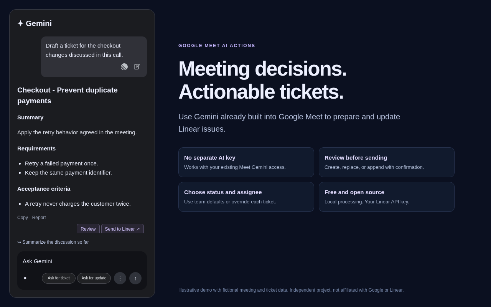
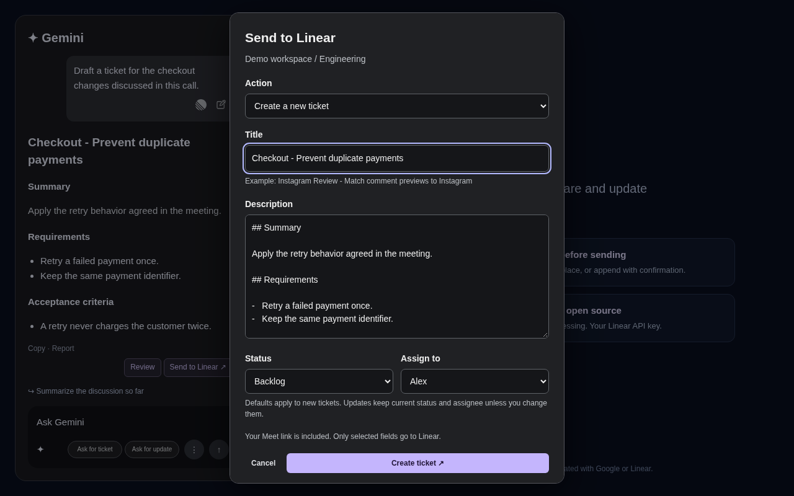

# Google Meet AI Actions

**Turn changes discussed in Google Meet into actionable Linear tickets using Gemini already built into Meet. No separate AI API key required.** Google Meet AI Actions is an open-source Chrome extension that connects Google Meet's Ask Gemini panel to Linear. Create tickets, update existing issues, choose a backlog/status and assignee, and review every write before sending.

[Features](#features) · [Setup](#setup) · [Create a ticket](#create-a-linear-ticket-from-a-meeting) · [Update a ticket](#update-an-existing-linear-ticket) · [Privacy](PRIVACY.md) · [Report an issue](https://github.com/nisgoswami/google-meet-ai-actions/issues)

> Independent community project. Not affiliated with or endorsed by Google or Linear. You need access to Ask Gemini in Google Meet; this extension does not provide a Gemini subscription or meeting transcription.

## What it does

During a Google Meet call, use **Action → Tickets → Create** to prepare a configurable Gemini prompt about one topic. The preset asks Gemini to capture the changes, decisions, requirements, and acceptance criteria discussed about that topic. Use **Send to Linear** on the resulting message, review the fields, and confirm.

For existing work, **Action → Tickets → Update** opens a searchable list of your team's Linear tickets, newest first. Choose a ticket to load its current text into the Gemini prompt, generate an updated draft from the call, and review the replacement or appended description.



## Features

| Feature | Behavior |
| --- | --- |
| Meeting discussion to Linear issue | Transfers the selected Gemini message into separate title and Markdown description fields. |
| Review before writing | Send opens a dialog with Create, Replace, and Append actions. No ticket write occurs on the first click. |
| Choose how to connect | Sign in with Linear through its permission screen, or bring your own team-restricted personal API key. OAuth uses PKCE with no developer backend or client secret in the extension. |
| Searchable ticket updates | Search titles, descriptions, or an exact issue ID. Recent tickets are ordered by creation date, newest first, with pagination. |
| Update detection | Recognizes team issue IDs, Linear issue links, selected update tickets, explicit update instructions, and exact title matches. Ambiguous matches require selection. |
| Backlog and status | Load the team's real workflow states, save a default, and override it before sending. Backlog is selected initially when available. |
| Assignees | Search the active team members loaded from Linear, choose a person per send, save a default, or leave a new ticket unassigned. Updates keep the current assignee unless changed. |
| Configurable Gemini prompts | Edit ticket and update templates in extension settings, with preset buttons and topic/ticket placeholders. |
| Formatting | Preserves headings, lists, emphasis, links, and code. Extracts Gemini's heading or styled title without repeating it in the description. |
| Safer updates | Checks the selected ticket for newer changes before sending and stops if the selection is stale. |
| Local processing | No extension backend, extra model API, analytics, audio recording, or caption collection. |
| Open source | MIT licensed, with source, tests, a privacy policy, and a repeatable package script. |

The prompt buttons float beside Gemini's three-dot control at the bottom of the composer. Per-message controls appear at the bottom right of prompts and answers.

Settings open on the **Linear** tab. **Jira**, **Notion**, and **Trello** have separate **Coming Soon** tabs; their integrations are not available yet.



Screenshots use fictional meeting and ticket data.

## Requirements

- Desktop Chrome or Chromium 116 or later.
- An eligible Google account with **Ask Gemini in Google Meet** enabled.
- A Linear account and target team. Choose Linear login or your own personal API key.
- Linear login requests **Read** and **Write** so it can read teams and tickets and create/update issues. You approve this on Linear's own consent screen, then choose a team in extension settings. The extension restricts its ticket operations to that team.
- For your own API key, choose **Read** plus **Create issues**, restricted to that team, for the complete flow. Linear's API-key Create issues capability includes updating issues. General Write, Comments, and Admin are not required for API keys.

Creation and manual description replacement can work with Create issues alone, but the read-based features above require Read permission. Android and iOS Meet apps are not supported.

## Setup

### 1. Load the extension

Install from the [Chrome Web Store](https://chromewebstore.google.com/detail/bhpafemdklaoobpenkfnhbdabahinfbm), or load the source locally:

```sh
git clone https://github.com/nisgoswami/google-meet-ai-actions.git
```

Open `chrome://extensions` in the profile you use for Meet. Enable **Developer mode**, select **Load unpacked**, and choose the cloned folder containing `manifest.json`.

### 2. Connect Linear

Open **Google Meet AI Actions settings** from the extension's toolbar icon.

**Sign in with Linear:** click the sign-in button, approve the permissions on Linear, choose the team returned by Linear, and click **Use this team**. Access tokens refresh automatically. Disconnect removes stored credentials and attempts to revoke the login with Linear.

**Bring your own API key:** expand this option in extension settings and follow these steps:

1. Sign in to the correct Linear workspace, open the workspace menu in the top left, and choose **Settings**.
2. Under **Personal**, open **Security & access**. You can also open [Security & access directly](https://linear.app/settings/account/security).
3. Find **Personal API keys** and click **New API key**.
4. Enter a descriptive name, such as `Google Meet AI Actions`.
5. Under **Permissions**, choose **Only select permissions**. Enable **Read** and **Create issues**. Leave **Full access**, **Write**, **Create comments**, and **Admin** off. The Create issues capability is described as **Create and update issues**.
6. Under **Team access**, choose **Only select teams** and add only the team you want the extension to use.
7. Click **Create**. Copy the generated `lin_api_...` key immediately and save it privately; treat it like a password. Do not paste it into Gemini, a GitHub issue, or a meeting chat.
8. In extension settings, paste the key into **Linear personal API key** and enter a workspace label, team name, and issue prefix, such as `ENG`.
9. To obtain the team UUID, open the team in Linear, press Ctrl/Cmd+K, choose **Copy model UUID**, select the **Team** entry, and paste the UUID into the extension.
10. Click **Save connection**, then **Load team statuses and people** to verify the read access and configure defaults.

This is a Linear **API key**, not an AI/model key. No Gemini API key, OpenAI API key, or paid extension subscription is needed. Google’s own Ask Gemini availability and subscription requirements still apply.

To change API-key permissions later, return to **Personal API keys**, open the key’s settings, choose **Edit API key**, and save only the required permissions and team restriction. Revoke the key there if it is compromised. For OAuth, manage the app's access in Linear's connected applications. The extension does not embed or publish user credentials.

### 3. Set ticket defaults and prompts

In settings, select **Load team statuses and people**. Choose a default status and assignee, then save. These defaults apply to new tickets; updates preserve existing values unless you change them in the Send dialog.

Edit the ticket and update prompt textareas, or use **Fill ticket preset** and **Fill update preset**, then save. Available placeholders:

| Placeholder | Value |
| --- | --- |
| `{{topic}}` | The topic or changes you want the draft to cover. |
| `{{issueId}}` | Selected issue identifier, such as `ENG-42`. |
| `{{issueTitle}}` | Selected issue's current title. |
| `{{issueDescription}}` | Selected issue's current Markdown description. |
| `{{teamPrefix}}` | Configured team prefix. |

Reload the extension after changing its source, then refresh Meet. Settings changes to saved prompts and defaults do not require a source reload.

## Create a Linear ticket from a meeting

1. Open **Ask Gemini** during the call.
2. Click **Action → Tickets → Create** and enter a topic, such as `Instagram comment preview layout`.
3. Prepare the prompt, then submit it using Gemini's own send button.
4. Click **Send to Linear** on the resulting draft.
5. Choose **Create a new ticket**, review title/description, status, and assignee, and confirm.

Preset title format:

```text
Page or Feature - Improvement or Bug Fix
```

Example:

```markdown
# Instagram Review - Match comment previews to Instagram

## Summary
Update comment previews based on the layout changes discussed in the call.


Screenshots use fictional meeting and ticket data.

## Requirements
- Keep replies and filters inside the relevant card.
- Match the agreed comment alignment and spacing.

## Acceptance criteria
- Previews use consistent alignment across cards.
- Replies remain inside their parent card at supported desktop widths.
```

The first heading becomes the Linear title. The remaining sections become the description. The canonical Meet link is appended as the source.

## Update an existing Linear ticket

Click **Action → Tickets → Update**, search the team's tickets, and select one. Its latest title and description are inserted into the configurable update prompt. The preset asks Gemini to preserve unchanged requirements and incorporate changes discussed in the call about your chosen topic.

After Gemini replies, **Send to Linear** opens Review with the issue selected. Choose:

- **Replace:** Replace checked fields with the reviewed draft. The title stays unchanged unless you check Replace title.
- **Append:** Add the reviewed details after the current description while preserving the title. For read-loaded tickets, the extension refreshes and checks the existing content. For manually entered IDs with a create-only key, paste the latest current description.
- **Create:** Explicitly create a separate ticket if that is your intent.

Update detection uses references and exact matches, not an additional AI service. It cannot reliably infer every existing ticket from a vaguely similar topic. Multiple matches require a choice. The timestamp check reduces stale writes but is not an atomic server-side lock.

## Privacy and permissions

The extension processes selected Gemini text locally. Linear API requests go directly to `https://api.linear.app/graphql`; no intermediary server receives them.

- API keys, configuration, prompt templates, default status/assignee IDs, and hashed delivery receipts stay in extension-local storage. Keys are restricted to trusted extension contexts and are not synced or exposed to Meet.
- Selected ticket text is inserted into Gemini only when you choose a ticket. Google receives the prepared prompt when you submit it.
- The extension does not record audio, read captions, retain meeting transcripts, collect analytics, or load remote scripts.
- Status/member lookups, exact-title checks, and ticket searches use the configured team's access boundary.
- Chrome permissions are limited to storage, identity for Linear OAuth, content scripts on Meet, and network access to the Linear API.
- Local storage is not encrypted against someone with access to the OS/browser profile. Revoke a compromised key in Linear.
- Removing the extension deletes its local storage. Disconnect removes the login tokens or key, destination, defaults, delivery receipts, and session ticket lists; saved prompt templates remain until changed or the extension is removed.

Read the full [privacy policy](PRIVACY.md). Do not include API keys or private meeting data in public bug reports.

## Frequently asked questions

### Does this connect Gemini's own tools to Linear?

No. Gemini drafts the text using the meeting context it can access. The extension transfers reviewed fields to Linear through your API key. It does not give Gemini a Linear MCP connection or autonomous issue access.

### Does it transcribe or record meetings?

No. It reads the Gemini message you select. Google Meet's own Gemini and note-taking features remain separate Google services.

### Does it work with the Android Gemini app or mobile Meet?

No. It is a desktop Chrome/Chromium extension and cannot modify native mobile apps.

### Can I update tickets without granting general Write access?

The issue-only Create issues capability supports issue updates. Read is additionally required for search, current-ticket loading, status/member selectors, and freshness checks. Keep the key restricted to your team.

### Can it assign a ticket automatically to a meeting participant?

No. Select a default or choose an active Linear team member in the Send dialog. It does not infer ownership from participants or transcript text.

### What if Gemini changes its interface?

The Meet adapter may need updating. Manual Review remains available for pasting a draft. Report a reproducible issue without exposing private meeting content.

## Development

```sh
npm ci
npm test
npm run test:browser
python3 scripts/package.py
```

Browser tests use `/usr/bin/chromium`, or `CHROMIUM_PATH`. Set `PLAYWRIGHT_PATH` to another installed Playwright module if needed. They load a disposable extension copy and mock Linear writes; they create no real issues.

The package script builds `dist/google-meet-ai-actions-<version>.zip` from an explicit runtime-file whitelist. Credentials, local configuration, dependencies, tests, and preview files are excluded.

### Automated releases

GitHub Actions runs unit and Chromium browser tests on pushes to `main` and pull requests. Use conventional commit prefixes such as `fix:` and `feat:`. After checks pass on `main`, Release Please opens or updates a release PR with a changelog and matching versions in `manifest.json`, `package.json`, and `package-lock.json`. CI also runs on the generated release PR.

Merge the release PR into `main` to release. Release Please creates the version tag and GitHub release, then its `release_created` output starts deployment in the same workflow. Deployment builds the ZIP, submits it to the Chrome Web Store for review, and attaches it to the GitHub release. Google publishes the update after approval. A pending store submission must be resolved before submitting a different version. If deployment fails after the release is created, rerun only the failed jobs to retry it.

Running **Release extension** manually from the Actions tab on `main` runs the checks and verifies store access without uploading or publishing. Manual runs on a release-PR branch only run CI. Deployment retries for a version already submitted or published do not upload it again.

Publishing uses GitHub OIDC and a dedicated Google service account through Workload Identity Federation; no permanent publishing key or refresh token is stored. The repository's Actions Variables contain `CWS_GCP_PROJECT_ID`, `CWS_WORKLOAD_IDENTITY_PROVIDER`, `CWS_SERVICE_ACCOUNT`, `CWS_PUBLISHER_ID`, and `CWS_EXTENSION_ID`. Google restricts authentication to this repository's numeric ID, owner, release workflow, and `main` or version-tag refs. The service account is registered with the Chrome Web Store publisher and has no general Google Cloud project roles.

| File | Responsibility |
| --- | --- |
| `adapters/google-meet.js` | Meet input, panel, messages, and menu anchoring. |
| `content.js` | Per-message controls, review, topic prompts, ticket picker, and status/assignee UI. |
| `background.js` | Linear requests, team validation, credential boundaries, defaults, and duplicate receipts. |
| `core.js` | Ticket parsing, update references, title separation, and canonical Meet URLs. |
| `prompts.js` | Preset templates and safe placeholder substitution. |
| `markdown.js`, `vendor/turndown.js` | Local HTML-to-Markdown conversion. |
| `options.*` | Connection, prompt, and ticket-default settings. |

## Roadmap

Linear is the supported destination today. Jira is a possible future integration if there is community interest; it is not implemented or promised for a particular date. If you would use it, [open or support a Jira feature request](https://github.com/nisgoswami/google-meet-ai-actions/issues) and describe your workflow without sharing private ticket data.

## Contributing and support

Use [GitHub Issues](https://github.com/nisgoswami/google-meet-ai-actions/issues) for bugs and feature requests. Include the extension version, Chrome version, expected behavior, and a sanitized reproduction. For code changes, explain the behavior and run the relevant tests. Never commit API keys, meeting transcripts, or personal ticket contents.

## License and references

[MIT license](LICENSE). Copyright Nishan Goswami. The bundled Turndown library is also MIT licensed; its license is included under `vendor/`.

Primary documentation: [Google Meet help](https://support.google.com/meet/), [Linear API](https://linear.app/developers/graphql), [Linear API permissions](https://linear.app/docs/api-and-webhooks), and [Chrome extension documentation](https://developer.chrome.com/docs/extensions/).

For AI tools and documentation consumers, see [llms.txt](llms.txt). This file provides a factual documentation map; it does not grant additional product capabilities or guarantee search ranking.

Use **Action → Tickets → Summarize Created Tickets** in Meet to view links to tickets created in that tab. **Summarize Tickets** prepares a prompt containing their links and saved creation details; submit it in Gemini when ready. The list survives reloads, ends when the tab closes, and can be cleared for a new call. It retains up to 100 tickets with 4,000 characters of description each; later Linear edits are not reflected.

Use **Action → Tickets → Create / Update / Summarize Created Tickets** in the Gemini composer. The summary prompt always starts with “Find the Tickets Here -”, followed by “Topics”, ticket titles, links, saved details, and the summary request. Submit it to Gemini when ready.
